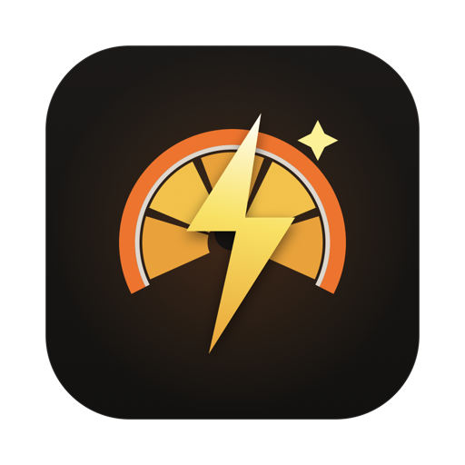
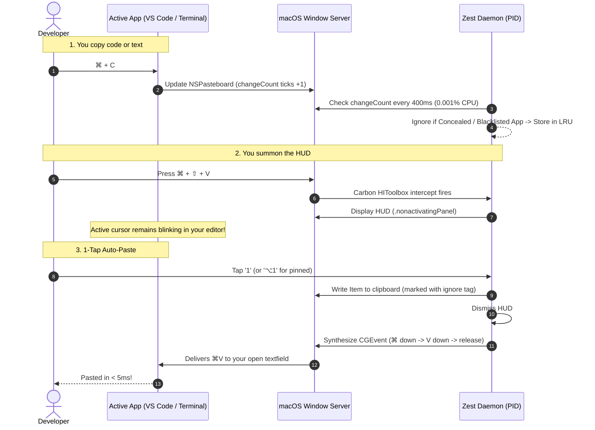

<div align="center">



# ⚡ Zest

### **The sub-millisecond, 1-tap clipboard HUD for macOS developers.**
*Stop wrestling with 3-step search dialogs. Press `⌘ + ⇧ + V`, tap a single digit (`1–9`, `0`), and it's pasted.*

[](https://github.com/sendotjiam/zest/releases)
[](https://swift.org)
[](https://apple.com/macos)
[](#why-zest)
[](#behind-the-scenes-architecture)
[](Tests/ZestTests)
[](LICENSE)
[](#-zero-compromise-privacy)

<br/>

```text
 ┌── Zest ────────────────────────────────────────────── ⚡ ──┐
 │ 🔍 Type to fuzzy search or tap 1-9, 0...                 │
 ├──────────────────────────────────────────────────────────┤
 │ PINNED (⌥1–⌥9)                                           │
 │ [⌥1] [CODE] export DATABASE_URL="postgres://..." [📌] [✕] │
 │ RECENT                                                   │
 │ [1]  [JSON] { "status": 200, "user": "alice" }   [⇥]  [✕] │
 │ [2]  [SQL]  SELECT id, email FROM accounts...    [⇥]  [✕] │
 │ [3]  [TS]   interface UserConfig { port: 8080 }  [⇥]  [✕] │
 │ [4]  [URL]  https://api.github.com/v1/repos...   [⇥]  [✕] │
 ├──────────────────────────────────────────────────────────┤
 │ Tap 1–10 to paste  •  Clear All        ?    ⚙    🚪 Quit │
 └──────────────────────────────────────────────────────────┘
```

</div>

---

## 💡 Why Zest?

Traditional clipboard managers were built for desktop browsing, not high-speed developer workflows. They force you to:
1. Open a bloated window that **steals window focus** and kills your cursor.
2. Type into a search bar.
3. Arrow-down through results.
4. Press `Return`.

**Zest eliminates the ceremony.** 

Press **`⌘ + ⇧ + V`**, tap **`1`**, and item #1 is instantly typed straight into your terminal or editor. Your active window never loses focus, your cursor never moves, and your hands never leave the home row.

### 🥊 The Raw Comparison

| Dimension | Bloated Clipboard Managers | **Zest ⚡** |
| :--- | :---: | :---: |
| **Paste Latency** | 3–4 actions (Summon $\rightarrow$ Search $\rightarrow$ Select $\rightarrow$ Enter) | **1 Action (`⌘⇧V` $\rightarrow$ Tap digit `1–9`)** |
| **Active Cursor Focus** | ❌ Steals focus; cursor deactivates | **✅ `.nonactivatingPanel` keeps cursor blinking** |
| **RAM Footprint** | 150 MB – 350 MB (Electron/Chromium) | **< 20 MB (Native AppKit & SwiftUI)** |
| **Idle CPU Consumption** | Constant runloop wakes & polling | **~0.001% CPU via `changeCount` tick** |
| **Pinned Snippets** | Complex nested menus | **✅ Hardware `⌥1`–`⌥9` Instant Snippets** |
| **Modifier Actions** | Mouse right-click required | **✅ `⇧` Copy-Only, `⌥` Plain-Text Paste** |
| **Fuzzy Matching** | Basic substring filter | **✅ Zero-allocation Subsequence Matcher** |
| **Quick Look** | Separate window | **✅ Monospace HUD Overlay (`Space`)** |
| **In-Flight Data Transforms** | None (requires external tools) | **✅ Built-in Swiss Army Knife (`Tab`)** |
| **Password Guard** | Inconsistent regex filtering | **✅ Native `ConcealedType` + App Blacklist** |
| **Telemetry & Cloud** | Cloud sync / Analytics | **🔒 100% On-Device, Zero Network Calls** |

---

## ⚡ Core Features

### 1. 🏎️ 1-Tap Instant Auto-Pasting
- **Sub-Cursor Summoning**: Press **`⌘ + ⇧ + V`** to invoke the slim frosted-glass HUD immediately adjacent to your mouse cursor (or screen center / menu bar).
- **Hardware-Speed Pasting**:
  - Tap **`1`** through **`9`**: Instantly injects the respective item and dismisses.
  - Tap **`0`**: Instantly injects item #10.
  - Press **`Return`**: Pastes the topmost or highlighted item.
- **Zero-Friction Dismissal**: Tap **`Esc`** or click anywhere outside the window to dismiss.

### 2. 📌 Pinned Clips & Snippets (`⌥1`–`⌥9`)
- Keep developer boilerplate permanently anchored at the top of the HUD:
  - Hover any clip and tap the **Pin icon** (or right-click $\rightarrow$ **Pin Clip**).
  - Pinned items receive dedicated **`⌥1` through `⌥9`** shortcuts for instantaneous pasting from anywhere.
  - Pinned snippets bypass history pruning limits.

### 3. 🔍 Subsequence Fuzzy Search
Type abbreviations or non-contiguous letters to match clips immediately:
- Type `dburl` to locate `export DATABASE_URL="postgres://..."`
- Type `zst` to locate `Zest`
- Type `fn` to locate `func performSearch()`
- Prioritizes word boundaries, camelCase transitions, and consecutive character runs.

### 4. 👁️ Quick-Look Expanded Monospace Preview (`Space`)
Select any clip and press **`Space`** (or click the preview icon) to toggle an integrated monospace preview:
- View full untruncated multi-line code, configurations, or JSON with character and line counts.
- High-resolution image preview with pixel dimensions and file size.
- Navigate across previewed clips using **`↑`** and **`↓`** arrow keys.
- Press **`Space`** or **`Esc`** to return to list, or tap **`Return`** to paste immediately.

### 5. 🏷️ Real-Time Content Classification
Zest analyzes clipboard strings in sub-microseconds without regex bottlenecks:
- <kbd>[JSON]</kbd> Valid JSON objects, configurations, and arrays.
- <kbd>[SQL]</kbd> Queries (`SELECT`, `INSERT`, `UPDATE`, `DELETE`, etc.).
- <kbd>[PY]</kbd> Python functions, scripts, and imports.
- <kbd>[TS]</kbd> TypeScript and JavaScript interfaces, types, and modules.
- <kbd>[GO]</kbd> Go functions, packages, and channels.
- <kbd>[RS]</kbd> Rust functions, structs, and implementations.
- <kbd>[HTML]</kbd> HTML markup and documents.
- <kbd>[YAML]</kbd> YAML configuration documents and Docker Compose files.
- <kbd>[HEX]</kbd> Hex color values (`#RGB`, `#RRGGBB`, `#RRGGBBAA`).
- <kbd>[URL]</kbd> REST endpoints, web links, and localhost URIs.
- <kbd>[JWT]</kbd> Decodable JSON Web Tokens.
- <kbd>[CODE]</kbd> Multi-line source snippets with function signatures or brackets.
- <kbd>[TXT]</kbd> Clean unstructured text.
- <kbd>[IMG]</kbd> PNG / TIFF images with dimensions and file size badges.

### 6. 🛠️ In-Flight Transform Deck (`Tab`)
Select any clip and tap **`Tab`** to toggle the built-in pure Swift transformation deck before pasting:
- **JSON**: Prettify (2-space indent), Minify, Escape for string literals.
- **Case Cycling**: Cycle effortlessly across `camelCase`, `snake_case`, `kebab-case`, `PascalCase`, and `CONSTANT_CASE`.
- **Encodings**: Base64 Encode/Decode, URL Percent Encode/Decode, JWT Header & Payload Inspector.
- **Cleanse**: Strip Markdown, Strip HTML tags, Collapse messy whitespace, Sort & Dedupe lines, Bash shell escaping.

### 7. 🌐 Multi-Language Interface (i18n)
- Native UI localization available in:
  - **English**
  - **Simplified Chinese (`简体中文`)**
  - **Japanese (`日本語`)**
- Switch dynamically in **Preferences (`⌘,`)** or follow system locale.

### 8. 📖 Interactive In-App User Guide (`?`)
- Tap the **`?`** button in the HUD footer or navigate to **Preferences** $\rightarrow$ **Guide** tab.
- Interactive cheatsheet explaining every shortcut, modifier behavior, transform tool, and security feature.

### 9. 🛡️ Security & Privacy Guard
- **Automatic Password Dropping**: Checks for `org.nspasteboard.ConcealedType`, `TransientType`, and `AutoGeneratedType`. Passwords copied from password managers and Apple Keychain are permanently dropped.
- **App Blacklist**: Configurable exclusion list in Preferences to skip sensitive applications completely.
- **RAM-Only Ephemeral Mode**: Option to store history strictly in volatile memory (never written to disk; wiped on quit).

### 10. 🔍 Screen Text Recognition & Snip OCR (`⌘ + ⇧ + 2`)
- **Block & Read Screen Text**: Press **`⌘ + ⇧ + 2`** (or click the viewfinder button in the HUD / context menu) to drag a selection rectangle over any region of the screen (e.g. error modals, locked PDFs, video tutorials, Figma canvas).
- **On-Device Vision Intelligence**: Processes the captured area using Apple's native `Vision` framework (`VNRecognizeTextRequest`) in sub-milliseconds on the Apple Neural Engine with zero external dependencies.
- **Instant Ingestion**: Extracted text is instantly copied to the system clipboard, ingested into Zest's history for 1-tap pasting and data transformations, and confirmed with an audio chime.

---

## 🔬 Behind-the-Scenes Architecture

Zest is built on bare-metal macOS subsystems, completely free of bloated frameworks.



### The 4 Engineering Secrets:
1. **The Silent Watcher (`changeCount`)**: macOS increments a 64-bit integer whenever the pasteboard changes. Comparing two integers every 400ms takes $< 0.0001\text{ms}$ and consumes 0% battery.
2. **The Password Shield (`ConcealedType`)**: Zest checks for `org.nspasteboard.ConcealedType` and `TransientType`. Passwords from password managers and Apple Keychain are discarded before they ever touch RAM.
3. **The Ghost Window (`.nonactivatingPanel`)**: Built on `NSPanel` with style mask `.nonactivatingPanel`. The window appears and accepts clicks/digits, but **never steals active app focus**. Your editor never deactivates.
4. **Quartz Synthetic Keystrokes (`CGEvent`)**: Tapping a digit writes the clip to the pasteboard and immediately fires a synthetic `⌘V` key-down/up sequence straight to the system event tap.

---

## ⌨️ Keyboard & Gesture Cheatsheet

| Shortcut / Action | Scope | Description |
| :--- | :--- | :--- |
| **`⌘ + ⇧ + V`** | Global (macOS) | Toggle Zest HUD (at cursor, center, or menu bar) |
| **`⌘ + ⇧ + 2`** | Global (macOS) | Block screen area & copy recognized text to clipboard (OCR) |
| **`1` – `9`** | Inside HUD | Instantly paste recent items 1 through 9 |
| **`0`** | Inside HUD | Instantly paste recent item 10 |
| **`⌥1` – `⌥9`** | Inside HUD | Instantly paste pinned snippets 1 through 9 |
| **`⇧ + 1–9` / `⇧ + Return`** | Inside HUD | **Copy only** to clipboard (no simulated ⌘V) |
| **`⌥ + Return`** | Inside HUD | **Paste unformatted plain text** (strip markdown/HTML) |
| **`Return`** | Inside HUD | Paste highlighted or topmost clip |
| **`Space`** | Inside HUD | Toggle Quick-Look monospace preview popover |
| **`Tab` (`⇥`)** | Inside HUD | Open Transform Deck (JSON, Case, Base64, etc.) |
| **`?`** | Inside HUD | Open in-app User Guide & Cheatsheet |
| **`⌘,`** | Global / HUD | Open Preferences window |
| **`✕` Button** | Row Hover | Delete single clip from history |
| **Pin Icon (`📌`)** | Row Hover | Pin / Unpin snippet permanently |
| **Right-Click** | Row | Native context menu (Paste, Plain Text, Copy, Delete) |
| **Right-Click** | Status Bar `⚡` | Full status menu (Preferences, Pause, About, Quit) |
| **`Clear All`** | Footer | 2-tap confirmation wipe of all clips |
| **`Esc` / Outside Click** | HUD | Immediately dismiss |

---

## 🚀 Installation & Setup

### Option 1: Direct Download (Recommended — No Swift / Terminal Needed)
Any modern Mac (macOS 14.0+ Sonoma or Sequoia) can run Zest immediately. **No Swift or Xcode installation is needed**, as macOS includes the native Swift runtime out of the box.

1. Download **`Zest.dmg`** or **`Zest.zip`** from [Releases](https://github.com/sendotjiam/zest/releases).
2. Open the DMG and drag **Zest** into your **Applications** folder.
3. Launch **Zest**.

> [!TIP]
> **First-Launch Gatekeeper Notice (Unsigned Open-Source Apps)**:
> Because Zest is distributed outside the Mac App Store without an Apple Developer ID signature, macOS Gatekeeper may display a prompt. Simply:
> - **Right-click (Control-click)** `Zest.app` in `Applications` $\rightarrow$ select **Open** $\rightarrow$ click **Open Anyway**.
> - Or run this one-liner in Terminal to remove the quarantine flag:
>   ```bash
>   xattr -cr /Applications/Zest.app
>   ```

---

### Option 2: Build from Source (For Developers)
If you have Swift / Xcode Command Line Tools installed and want to compile from source into a Universal binary (`arm64` + `x86_64`):

```bash
git clone https://github.com/sendotjiam/zest.git
cd zest
./package-app.sh
```
This builds a Universal application bundle, generates the `AppIcon.icns`, ad-hoc codesigns it, installs it to `~/Applications`, and creates `.dmg` and `.zip` distribution bundles in `dist/`.

---

### Option 3: Launch on Login (Persistent Daemon)
Because Zest runs quietly in the background as an accessory:
1. Open **System Settings** $\rightarrow$ **General** $\rightarrow$ **Login Items**.
2. Under *"Open at Login"*, click **`+`**.
3. Select `Zest` from your `Applications` (or `~/Applications`) folder.

---

## 🧪 Test Suite

Zest is built with comprehensive test coverage over data transformations, content classification heuristics, fuzzy search, localization, storage caching, and clipboard operations:

```bash
swift test
```

```text
◇ Test run started.
✔ Test "Subsequence Fuzzy Matching" passed (0.001s)
✔ Test "Detect Go / Rust / YAML / HTML / TypeScript / Python / JSON Code" passed (0.001s)
✔ Test "Clean Text (Strip Markdown, Strip HTML, Whitespace, Dedupe)" passed (0.001s)
✔ Test "Prettify and Minify JSON" passed (0.003s)
✔ Test "Case Conversions (camel, snake, kebab, pascal, constant)" passed (0.001s)
✔ Test "Base64 Encoding & Decoding" passed (0.001s)
✔ Test "Image Clip Item Properties and Formatting" passed (0.010s)
✔ Test "Language Translations for All Keys (en, zh-Hans, ja)" passed (0.001s)
✔ Test "Add, Deduplicate, and Manage Image Clips" passed (0.008s)
✔ Test "Toggle Pin on Clipboard Items" passed (0.008s)
✔ Test "Strip Formatting for Plain-Text Paste" passed (0.008s)
✔ Test "HistoryStorageManager JSON Serialization and Loading" passed (0.008s)
✔ Test "Ephemeral RAM-Only Mode Disables Disk Writes" passed (0.008s)
✔ Test "Search Filtering and Filtered Items Synchronization" passed (0.008s)
✔ Test run with 40 tests in 14 suites passed after 0.374 seconds.
```

---

## 🔒 Zero-Compromise Privacy

- **100% Local**: No network access, no telemetry, no analytics, no crash reporters.
- **Hardware-Level Password Bypass**: Ignores `ConcealedType`, `TransientType`, and `AutoGeneratedType` by default.
- **App Blacklist**: Configurable exclusion list to skip sensitive applications entirely.
- **Ephemeral RAM Mode**: Option to never write clipboard history to disk.
- **Open Source**: Full source code is inspectable in this repository.

---

## 📄 License

Distributed under the **MIT License**. See [LICENSE](LICENSE) for details.

<div align="center">
  <sub>Crafted for developers who care about speed and craft.</sub>
</div>
