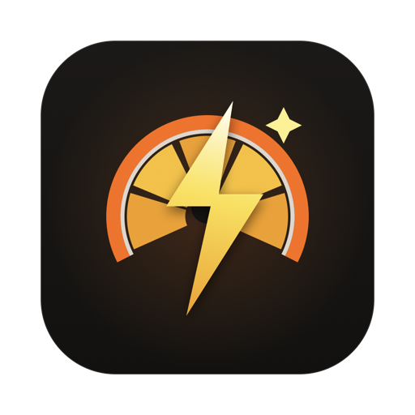
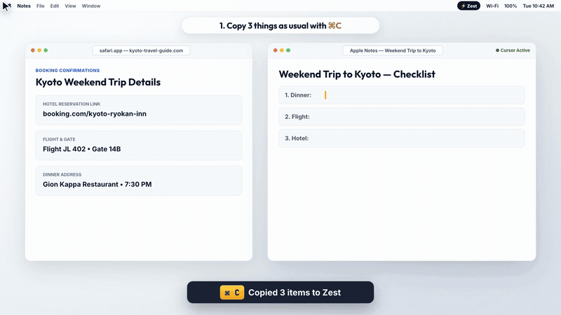

<div align="center">



# ⚡ Zest

**Sub-millisecond, 1-tap clipboard HUD for macOS.**  
Press `⌘⇧V`, tap a digit (`1–9`, `0`), and paste straight into your active app without stealing window focus.

[](https://swift.org)
[](https://apple.com/macos)
[](#-architecture--privacy)
[](Tests/ZestTests)
[](#-architecture--privacy)
[](LICENSE)

<br/>

<a href="https://sendotjiam.me/zest#demo">
  
</a>
<br/>
<sub>Auto-playing preview • <a href="https://sendotjiam.me/zest#demo">Watch 1080p with audio</a> • <a href="assets/zest-promo.mp4">Download MP4</a></sub>

</div>

---

## ⚡ Features

- **1-Tap Instant Paste (`⌘⇧V` → `1–9`, `0`)** — Summons next to your cursor (or center / menu bar) and injects immediately via synthetic `CGEvent` without deactivating your editor.
- **Pinned Snippets (`⌥1–⌥9`)** — Anchor frequently used commands, URLs, or credentials at the top of the HUD, exempt from history pruning.
- **Screen Text OCR (`⌘⇧2`)** — Drag over any image, error modal, or video frame to extract text on-device using Apple's `Vision` framework.
- **In-Flight Transform Deck (`Tab`)** — Prettify/minify JSON, cycle identifier case (`camelCase`, `snake_case`, `kebab-case`, `PascalCase`, `CONSTANT_CASE`), Base64/URL encode/decode, inspect JWTs, or strip Markdown/HTML before pasting.
- **Quick Look & Fuzzy Search (`Space`)** — Instant subsequence search across syntax-tagged clips (`JSON`, `SQL`, `TS`, `PY`, `GO`, `RS`, `HTML`, `YAML`, `HEX`, `URL`, `JWT`, `IMG`) with full monospace/image preview.
- **Warm Citrus Liquid Glass HUD (`◐`)** — Auto, Light, and Dark modes with English, `简体中文`, and `日本語` localization.

---

## ⌨️ Shortcuts

| Shortcut | Action |
| :--- | :--- |
| **`⌘⇧V`** | Toggle Zest HUD |
| **`⌘⇧2`** | Snip screen area & copy recognized text (OCR) |
| **`1–9`, `0`** / **`Return`** | Paste recent item 1–10 / highlighted item |
| **`⌥1–⌥9`** | Paste pinned snippet 1–9 |
| **`⇧` + digit / `Return`** | Copy only (without auto-paste) |
| **`⌥ + Return`** | Paste unformatted plain text |
| **`Space`** / **`Tab`** | Toggle Quick Look preview / Transform Deck |
| **`⌘,`** / **`Esc`** | Open Preferences / Dismiss HUD |

---

## 🚀 Installation

### Direct Download (macOS 14.0+)
1. Download **`Zest.dmg`** or **`Zest.zip`** from [Releases](https://github.com/sendotjiam/zest/releases) and drag **Zest** to **Applications**.
2. On first launch (unsigned build), right-click **Zest.app** → **Open** (or run `xattr -cr /Applications/Zest.app`).

### Build from Source
```bash
git clone https://github.com/sendotjiam/zest.git && cd zest
./package-app.sh
```
Verify with the test suite:
```bash
swift test   # 41 tests across 14 suites
```

---

## 🔬 Architecture & Privacy

- **`.nonactivatingPanel` HUD** — Built on native AppKit `NSPanel` + SwiftUI (`< 20 MB` RAM); receives keystrokes without stealing focus from your active app.
- **`changeCount` Watcher** — Polls pasteboard integer counter every 400ms (`~0.001%` CPU).
- **100% On-Device Privacy** — Zero network calls or telemetry. Automatically drops `ConcealedType` / `TransientType` / `AutoGeneratedType` passwords, supports an app blacklist, and includes an ephemeral RAM-only mode.

---

## 📄 License

[MIT](LICENSE)
